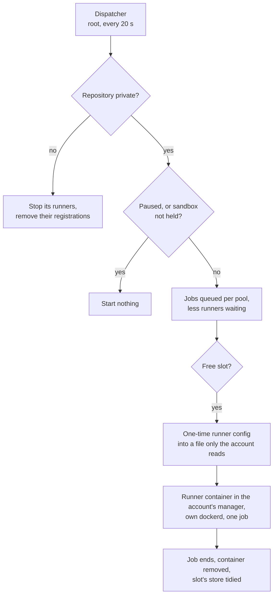

# hostkit

`joonalai.hostkit`, an Ansible collection of roles for self-hosted Debian
servers. Each role is configured entirely from the consumer's inventory.

| Role                      | What it does                                                                |
| ------------------------- | --------------------------------------------------------------------------- |
| `rootless_account`        | An account that runs rootless podman containers from its systemd manager    |
| [`ci_runner`](#ci_runner) | One-job GitHub Actions runners for private repositories, in such an account |

The roles need Debian with systemd and rootless podman, and Ansible 2.18 or
newer on the controller.

## Hardening is the host's

No role here changes the firewall, sshd or anything else that hardens the
host. A role that runs untrusted code says what the host must hold off,
takes the host's own unit for it as a variable, and refuses to run without
it. See [What the host must provide](#what-the-host-must-provide).

## Installing

In the consumer's `requirements.yml`, pinned to a tag or a commit:

```yaml
collections:
  - name: https://github.com/Joonalai/ansible-hostkit.git
    type: git
    version: <tag or commit>
```

```sh
ansible-galaxy collection install -r requirements.yml
```

## ci_runner

Runs the checks and tests of private GitHub repositories on the host. A root
service, the dispatcher, asks GitHub for the jobs queued for the host's
label and starts a runner for each in an account of its own. A runner takes
one job in a fresh rootless container with a Docker engine of its own, and
the container is removed with the job.



- **Private repositories only.** The dispatcher checks each repository's
  visibility on every poll and removes the runners and the variable of one
  that has turned public. A pull request in a public repository could
  otherwise ask for the host by its label.
- **The token stays with root.** Registering a runner needs a token with
  administration rights on the repositories. The dispatcher holds it and
  gives each runner a one-time configuration for one job.
- **Two pools.** A pull request's jobs ask for the label with `-pr` and get
  Docker stores and caches of their own, so a pull request cannot leave an
  image or a cache entry that a job on the default branch then trusts. The
  pools share the slots.
- **Warm starts.** Each slot keeps its Docker store and tool caches between
  jobs. The images in `ci_runner_warm_images` are pulled once and kept as
  files root owns, which every slot loads from and none can change.
- **Not privileged.** The runner's container gets no device of the host.

### What the host must provide

The jobs are unreviewed code, and the role does not sandbox them. The host
does, and names the unit that does it in `ci_runner_sandbox_unit`. The
role asserts the unit is loaded and active, and makes the account's systemd
manager and the dispatcher require it, so stopping the unit stops every job.

The host's sandbox must hold:

- **Who:** every packet of the account `ci_runner_account`, and of its
  subordinate ID range, `ci_runner_subuid_start` and the
  `ci_runner_subuid_count` IDs from it. Rootless podman's network helper
  runs as the account itself, so a match on the socket's owner covers the
  containers.
- **Must reach:** the internet over IPv4 on TCP 443 and 80, for GitHub,
  packages and images, and the host's resolvers on port 53.
- **Must not reach:** any address of the host itself, its LAN, a VPN or
  overlay network it is on, link-local and other reserved ranges, broadcast
  and multicast. IPv6 too, unless the host filters it as carefully.

Two traps for whoever writes those rules:

- Match the account's packets and send only those to the checks. A rule
  that accepts "everything not the account's" and rejects the rest also
  rejects the kernel's own packets, which have no owner, and takes the host
  off its networks.
- A firewall's rules can be flushed while their unit still reads active.
  Give `ci_runner_sandbox_check` a command that exits 0 only while the
  rules are in the kernel. The dispatcher runs it before it starts runners.

### A minimal playbook

```yaml
- name: CI runners
  hosts: ci
  roles:
    - role: joonalai.hostkit.ci_runner
      vars:
        ci_runner_sandbox_unit: ci-sandbox.service
        ci_runner_sandbox_check: [/usr/local/sbin/ci-sandbox-check]
        ci_runner_subuid_start: 300000
        ci_runner_repos: [example/app]
        ci_runner_github_token: "{{ vault_ci_runner_github_token }}"
        ci_runner_memory_max: 8G
        ci_runner_cpu_quota: 400%
```

`ci-sandbox.service` and its check are the host's own and must be in place
before this play. Every variable is described in
[`roles/ci_runner/defaults/main.yml`](roles/ci_runner/defaults/main.yml).

In a workflow, a job picks the host only while the repository is private and
the variable is set, and GitHub's runners otherwise:

```yaml
runs-on: >-
  ${{ github.event.repository.private && vars.CI_RUNNER
      && format('{0}{1}', vars.CI_RUNNER, github.event_name == 'pull_request' && '-pr' || '')
      || 'ubuntu-latest' }}
```

### Running it

```sh
ci-runner-dispatcher pause     # start no runner until resumed, running jobs finish
ci-runner-dispatcher resume
ci-runner-dispatcher stop      # stop every runner now
journalctl -u ci-runner-dispatcher
```

The command is named after `ci_runner_name`. Setting `ci_runner_enabled` to
`false` and running the play takes CI off the host and out of GitHub: the
variables, the runners, the account with its images and caches, and the
service. It fails if anything is left. The sandbox is then the host's to
remove.

## Development

```sh
uv sync --locked
.venv/bin/prek install
.venv/bin/prek run --all-files
```

## Licence

MIT, see [LICENSE](LICENSE).
