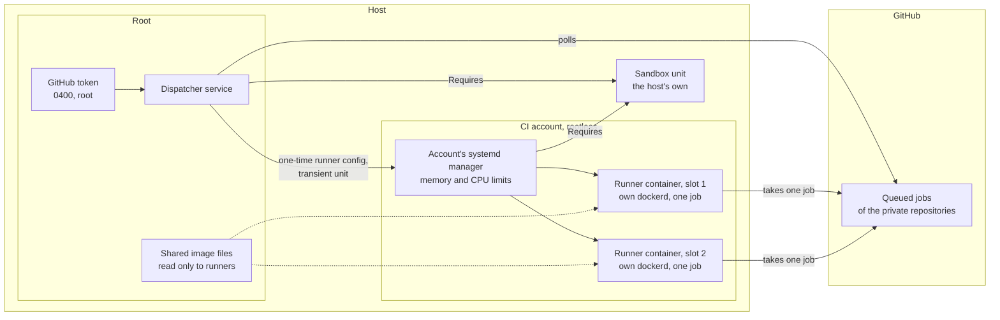
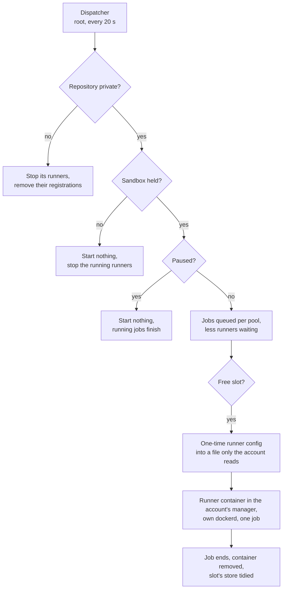
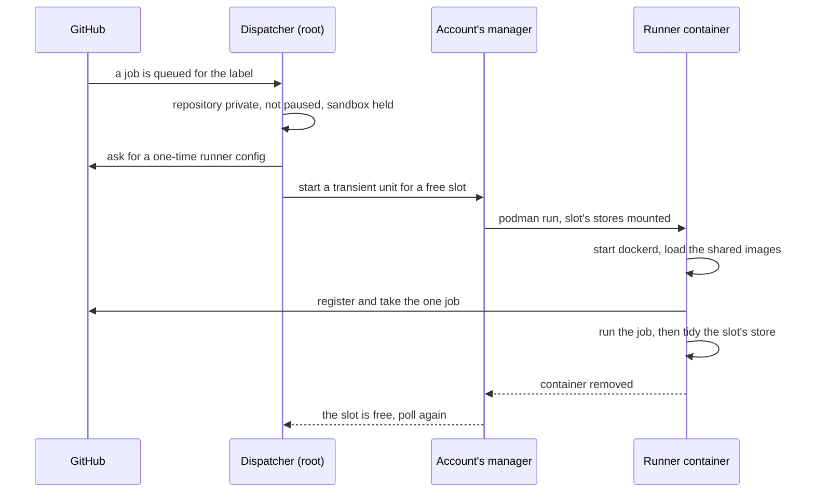
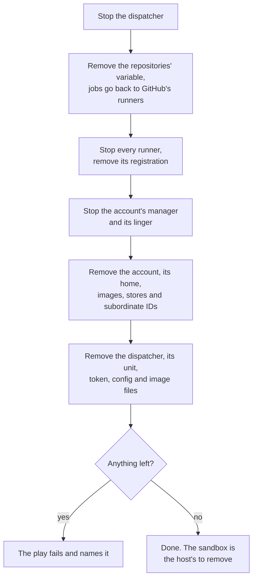

# ci_runner

Runs the checks and tests of private GitHub repositories on the host. A root
service, the dispatcher, asks GitHub for the jobs queued for the host's
label and starts a runner for each in an account of its own. A runner takes
one job in a fresh rootless container with a Docker engine of its own, and
the container is removed with the job.

## What is where



- **Private repositories only.** The dispatcher checks each repository's
  visibility on every poll and removes the runners and the variable of one
  that has turned public. A pull request in a public repository could
  otherwise ask for the host by its label.
- **The token stays with root.** Registering a runner needs a token with
  administration rights on the repositories. The dispatcher holds it and
  gives each runner a one-time configuration for one job.
- **Two pools.** A pull request's jobs ask for the label with `-pr` and get
  Docker stores and caches of their own, so a pull request cannot leave an
  image or a cache entry that a job on the default branch then trusts. The
  pools share the slots.
- **Warm starts.** Each slot keeps its Docker store and tool caches between
  jobs. The images in `ci_runner_warm_images` are pulled once and kept as
  files root owns, which every slot loads from and none can change.
- **Not privileged.** The runner's container gets no device of the host.

## A poll



## A job



## What the host must provide

The jobs are unreviewed code, and the role does not sandbox them. The host
does, and names the unit that does it in `ci_runner_sandbox_unit`. The
role asserts the unit is loaded and active, and makes the account's systemd
manager and the dispatcher require it, so stopping the unit stops every job.

The host's sandbox must hold:

- **Who:** every packet of the account `ci_runner_account`, and of its
  subordinate ID range, `ci_runner_subuid_start` and the
  `ci_runner_subuid_count` IDs from it. Rootless podman's network helper
  runs as the account itself, so a match on the socket's owner covers the
  containers.
- **Must reach:** the internet over IPv4 on TCP 443 and 80, for GitHub,
  packages and images, and the host's resolvers on port 53.
- **Must not reach:** any address of the host itself, its LAN, a VPN or
  overlay network it is on, link-local and other reserved ranges, broadcast
  and multicast. IPv6 too, unless the host filters it as carefully.

Two traps for whoever writes those rules:

- Match the account's packets and send only those to the checks. A rule
  that accepts "everything not the account's" and rejects the rest also
  rejects the kernel's own packets, which have no owner, and takes the host
  off its networks.
- A firewall's rules can be flushed while their unit still reads active.
  Give `ci_runner_sandbox_check` a command that exits 0 only while the
  rules are in the kernel. The dispatcher runs it on every poll: while it
  fails no runner starts, and the running ones are stopped.

A restart of the sandbox unit stops every job, since the account's manager
requires it. A host that changes its rules reloads the unit instead.

The role also needs an x86-64 host: the runner image downloads its tools as
x86-64 binaries.

## Variables

Required, with no usable default:

| Variable                 | What it is                                                         |
| ------------------------ | ------------------------------------------------------------------ |
| `ci_runner_sandbox_unit` | The host's unit that sandboxes the account, by its full name       |
| `ci_runner_subuid_start` | The start of the account's subordinate ID range                    |
| `ci_runner_repos`        | The repositories served, as `owner/name`                           |
| `ci_runner_github_token` | The token that registers runners, from the consumer's secret store |

The token is fine-grained and covers only the repositories served:
Administration read and write, Actions read, Variables read and write,
Metadata read.

Optional:

| Variable                     | Default                  | What it is                                                                    |
| ---------------------------- | ------------------------ | ----------------------------------------------------------------------------- |
| `ci_runner_enabled`          | `true`                   | `false` takes CI off the host and out of GitHub                               |
| `ci_runner_name`             | `ci-runner`              | What every file, unit, container and label is named after                     |
| `ci_runner_account`          | the name                 | The account the runners run as                                                |
| `ci_runner_account_uid`      | the system's choice      | Pin it when the host's sandbox names the account by number                    |
| `ci_runner_subuid_count`     | `65536`                  | The size of the range, at least 65536                                         |
| `ci_runner_sandbox_check`    | `[]`                     | A command that exits 0 only while the sandbox's rules are in place            |
| `ci_runner_memory_max`       | none                     | Memory of everything the account runs, such as `8G`                           |
| `ci_runner_memory_swap_max`  | none                     | How much of that may sit in swap                                              |
| `ci_runner_cpu_quota`        | none                     | CPU time of everything the account runs, such as `400%`                       |
| `ci_runner_label`            | the name                 | The label the jobs ask for, with `-pr` added for pull requests                |
| `ci_runner_variable`         | `CI_RUNNER`              | The repository variable that sends a workflow's jobs to the host              |
| `ci_runner_slots`            | `2`                      | How many jobs run at once, 1 to 8                                             |
| `ci_runner_job_max_seconds`  | `3600`                   | The longest a job may run                                                     |
| `ci_runner_job_env`          | `{}`                     | Environment of every job. Shows in argument lists, so never a secret          |
| `ci_runner_poll_seconds`     | `20`                     | The time between polls                                                        |
| `ci_runner_timing_keep_days` | `90`                     | Days of records of where each job's time went. 0 records nothing              |
| `ci_runner_timing_group`     | none                     | A group of the host's that reads the records and runs the report without root |
| `ci_runner_image`            | a local tag off the name | The runner image, built on the host as the account                            |
| `ci_runner_image_extra`      | none                     | Containerfile lines added to the image, pinned by checksum or digest          |
| `ci_runner_warm_images`      | `[]`                     | The images the jobs use, by digest, pulled once for every slot                |

Each is described in full in
[`roles/ci_runner/defaults/main.yml`](../roles/ci_runner/defaults/main.yml).

## A minimal playbook

```yaml
- name: CI runners
  hosts: ci
  roles:
    - role: joonalai.hostkit.ci_runner
      vars:
        ci_runner_sandbox_unit: ci-sandbox.service
        ci_runner_sandbox_check: [/usr/local/sbin/ci-sandbox-check]
        ci_runner_subuid_start: 300000
        ci_runner_repos: [example/app]
        ci_runner_github_token: "{{ vault_ci_runner_github_token }}"
        ci_runner_memory_max: 8G
        ci_runner_cpu_quota: 400%
```

`ci-sandbox.service` and its check are the host's own and must be in place
before this play.

In a workflow, a job picks the host only while the repository is private and
the variable is set, and GitHub's runners otherwise:

```yaml
runs-on: >-
  ${{ github.event.repository.private && vars.CI_RUNNER
      && format('{0}{1}', vars.CI_RUNNER, github.event_name == 'pull_request' && '-pr' || '')
      || 'ubuntu-latest' }}
```

## Running it

```sh
ci-runner-dispatcher pause     # start no runner until resumed, running jobs finish
ci-runner-dispatcher resume
ci-runner-dispatcher stop      # stop every runner now
journalctl -u ci-runner-dispatcher
```

The command is named after `ci_runner_name`.

## Where the time goes

The dispatcher records where each job's time goes, from GitHub queueing it
to its runner's container being removed, in
`/var/lib/<name>/timing/`, a JSON line per job, per runner stopped unused
and per poll sample, in a file per UTC day. It keeps
`ci_runner_timing_keep_days` of them, 90 by default, and 0 records
nothing. The report reads them:

```sh
sudo ci-runner-dispatcher report      # the last 14 days
sudo ci-runner-dispatcher report 60
```

Only root reads them, unless `ci_runner_timing_group` names a group of the
host's, whose members then read the records and run the report without
sudo, as `/usr/local/sbin/ci-runner-dispatcher report`. The records name
the private repositories, their workflows and their jobs.

Per pool, the count, median, 90th percentile and longest of each part of a
job's time:

| Part               | From → to                                                  |
| ------------------ | ---------------------------------------------------------- |
| queue              | GitHub queued it → a runner took it                        |
| not yet seen       | queued → a poll listed it                                  |
| waiting for a slot | what is left of the queue, also a runner busy with another |
| starting           | its runner's unit started → the runner took it             |
| the job            | taken → GitHub says it completed                           |
| tidying            | completed → the container removed and its slot free again  |

Then the slots' use by hour of day, and how often every slot was busy while
a job waited; the slot-minutes runners held without taking a job, and why
they were stopped; how long polls took; and the slowest starts.

How to read it: *not yet seen* long while polls are quick says poll more
often (`ci_runner_poll_seconds`); *waiting for a slot* long while the slots
are saturated says more slots, if the account's memory allows them; long
*starting* is the runner's own start, dockerd and loading the warm images;
long *tidying* holds the slot after the job. A job that another host's
runner took has its queue but no split of it.

## Taking it off

Setting `ci_runner_enabled` to `false` and running the play takes CI off the
host and out of GitHub, and fails if anything is left.



The packages and `rootless_account`'s image rebuild script stay, since
other accounts share them.
