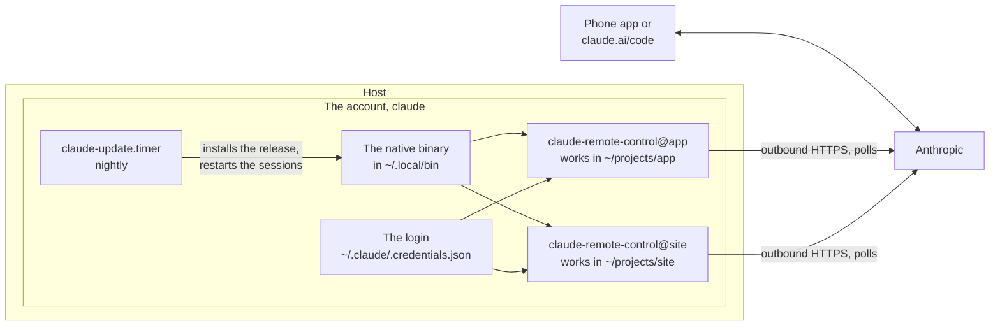
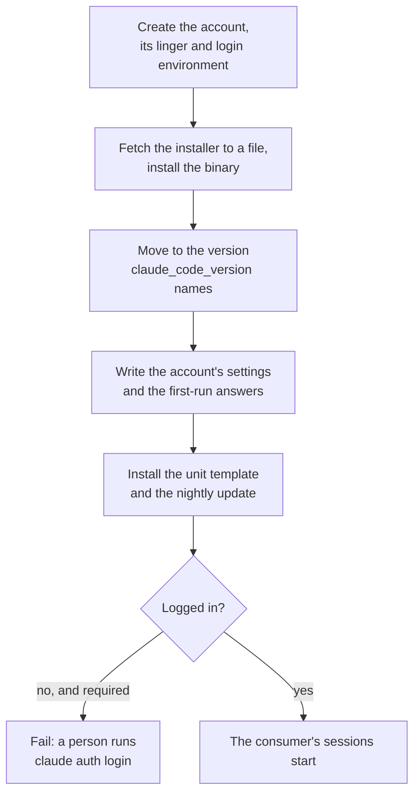

# claude_code

Claude Code on the host as a Remote Control server: an account, the native
binary, and a `claude-remote-control@<dir>` user unit template that runs a
session in `~/projects/<dir>`. The Claude phone app or claude.ai/code opens
the session. What runs in a session, which checkout and which permissions,
is a consumer role's, such as [`workbench`](workbench.md).

## What is where



- **It dials out, so it needs no port.** Remote Control registers with
  Anthropic over outbound HTTPS and polls. Nothing listens, so it works
  behind CGNAT and needs no firewall entry and no VPN.
- **A subscription login, done once by a person.**
  `sudo -iu claude claude auth login` prints a URL and takes back a code.
  The role refuses to run a session without the login.
- **The version is the play's decision.** `claude_code_version` names a
  channel or a version. The play installs it on every run, and a timer does
  the same every night, restarting the sessions onto the new binary.
- **No auto mode and no bypass** in the account's settings by default. A
  consumer carries its deny rules per checkout.
- **Every restart is a new session on the phone.** Remote Control cannot
  resume the old one from a unit.

## A play



## What the host must provide

- Debian with systemd, and outbound HTTPS.
- A person to log in once as the account. The login expires on its own, and
  the unit then loops until someone logs in again. A host that depends on a
  session should watch for running `claude remote-control` processes.
- A sandbox, where the sessions run code nobody reviewed. The role does not
  sandbox the account. A consumer role that needs one, as `workbench` does,
  ties the account's manager to the host's sandbox units through
  [`rootless_account`](rootless_account.md).

The installer and the releases are downloaded from Anthropic at run time,
and `latest` is the default channel. Set `claude_code_version` to a version
to pin it.

## Variables

All are optional:

| Variable                         | Default                           | What it is                                                        |
| -------------------------------- | --------------------------------- | ----------------------------------------------------------------- |
| `claude_code_user`               | `claude`                          | The account. One account, one login, however many projects        |
| `claude_code_uid`                | the system's choice               | Pin it when the host's firewall names the account by number       |
| `claude_code_home`               | `/home/<user>`                    | The account's home                                                |
| `claude_code_projects_dir`       | `<home>/projects`                 | Each session is a directory here, named as its unit instance      |
| `claude_code_version`            | `latest`                          | `stable`, `latest` or `x.y.z`                                     |
| `claude_code_update_on_calendar` | `*-*-* 04:00:00`                  | When the nightly update runs                                      |
| `claude_code_update_restarts`    | `claude-remote-control@*.service` | The units the update restarts, as a glob. Empty restarts none     |
| `claude_code_settings`           | no auto mode, no bypass           | The account's `~/.claude/settings.json`                           |
| `claude_code_login_required`     | `true`                            | `false` in a test container, which installs but starts no session |

Each is described in full in
[`roles/claude_code/defaults/main.yml`](../roles/claude_code/defaults/main.yml).

## Using it

```yaml
- name: Claude Code
  hosts: bench
  roles:
    - role: joonalai.hostkit.claude_code
```

A consumer role adds a session by enabling an instance of the template for
its checkout, and includes the role's `state` tasks so the checkout is
trusted without a prompt nobody can answer:

```yaml
- name: Trust the checkout
  ansible.builtin.include_role:
    name: joonalai.hostkit.claude_code
    tasks_from: state
  vars:
    claude_code_state:
      hasTrustDialogAccepted: true
    claude_code_project_dir: /home/claude/projects/app
```

A second Claude Code account is a second play, with the account as play
vars: the role is written for one account at a time.
