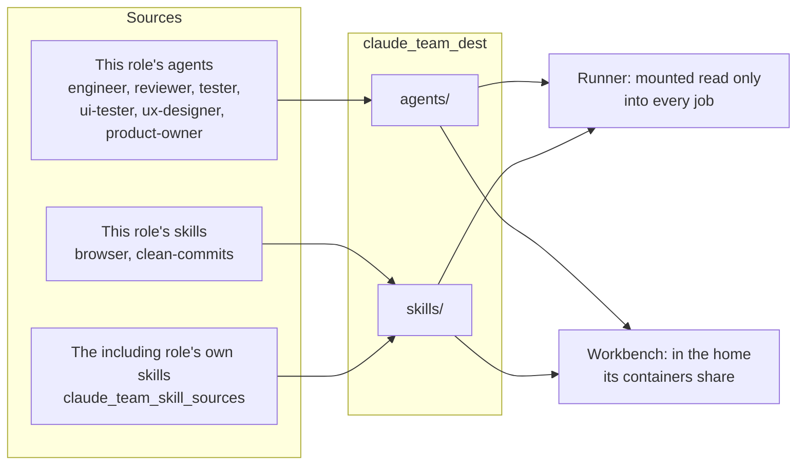
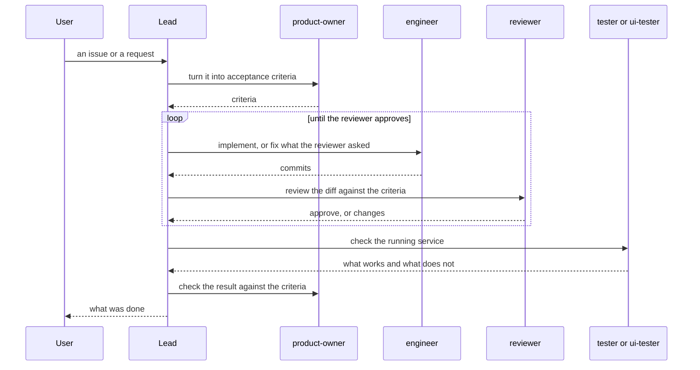

# claude_team

Installs Claude's team: the subagent roles a lead calls one at a time, and
the skills they load as they need them. The team is files. Two roles
include this one and install the same files:
[`github_runner`](github_runner.md) for its jobs and
[`workbench`](workbench.md) for its sessions.

## What it installs



- **One source for both environments.** A role changed here changes for the
  runner's jobs and the workbench's sessions alike.
- **The process is not here.** A subagent knows only its prompt and these
  files. How the lead runs the rounds, opens PRs and stops is in the
  including role's own rules.
- **Skills of the same name mean the right thing in each place.** The
  shared skills go in first and the including role's own after them, into
  one directory. `preview` is the runner's compose procedure in a job and
  the dev server on the workbench.
- **The copy does not delete.** A role or a skill removed from the sources
  stays at the destination until removed by hand.

## How a lead uses the team



Which of the roles a piece of work gets depends on its level, which the
including role's rules decide. `ux-designer` joins before the engineer on
work that changes what users see.

## What the host must provide

Nothing of its own. The role only copies files, as root, to a directory the
including role names.

## Variables

Required:

| Variable           | What it is                                      |
| ------------------ | ----------------------------------------------- |
| `claude_team_dest` | The directory that gets `agents/` and `skills/` |

Optional:

| Variable                     | Default   | What it is                                                        |
| ---------------------------- | --------- | ----------------------------------------------------------------- |
| `claude_team_owner`          | `root`    | The files' owner                                                  |
| `claude_team_group`          | the owner | The files' group                                                  |
| `claude_team_mode`           | `0644`    | The files' mode                                                   |
| `claude_team_directory_mode` | `0755`    | The directories' mode                                             |
| `claude_team_skill_sources`  | `[]`      | Directories of the including role's own skills, `<name>/SKILL.md` |

## Using it

```yaml
- name: Install the team
  ansible.builtin.include_role:
    name: joonalai.hostkit.claude_team
  vars:
    claude_team_dest: /home/coder/claude
    claude_team_owner: root
    claude_team_skill_sources: ["{{ role_path }}/files/skills"]
```

A workstation can also read the files in place: a Claude Code plugin can
link `files/agents` and `files/skills` from an installed copy of the
collection, with no play and no copy.
