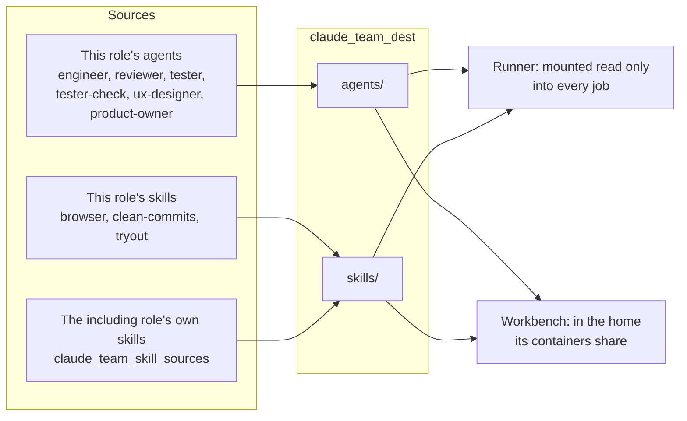
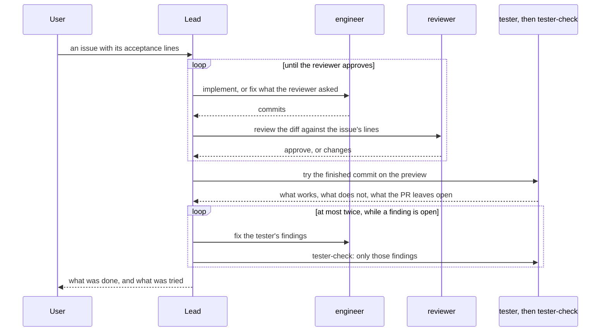

# claude_team

Installs Claude's team: the subagent roles a lead calls one at a time, and
the skills they load as they need them. The team is files. Two roles
include this one and install the same files:
[`github_runner`](github_runner.md) for its jobs and
[`workbench`](workbench.md) for its sessions.

## What it installs



- **One source for both environments.** A role changed here changes for the
  runner's jobs and the workbench's sessions alike.
- **The process is not here.** A subagent knows only its prompt and these
  files. How the lead runs the rounds, opens PRs and stops is in the
  including role's own rules.
- **Skills of the same name mean the right thing in each place.** The
  shared skills go in first and the including role's own after them, into
  one directory. `preview` is the runner's compose procedure in a job and
  the dev server on the workbench.
- **The copy does not delete.** A role or a skill removed from the sources
  stays at the destination until removed by hand. The one exception is a
  role the team retired, `ui-tester`, which the role removes by name.

## How a lead uses the team



Which of the roles a piece of work gets depends on its level, which the
including role's rules decide. The issue's own acceptance lines are the
criteria, word for word; `product-owner` joins first and last only for an
issue with none. `ux-designer` designs before the engineer and reviews
after the tester on work that changes what users see and has no mockup.
`tester` follows the `tryout` skill, on Opus; `tester-check`, on Sonnet,
looks again only at its findings.

The `browser` skill drives a page with Playwright for Python through `uv`,
on the box's own Chromium, or on a browser the repository's stack serves
when its instructions give that browser's address. A served browser saves
the job the memory of its own. Playwright refuses a server whose
major.minor differs from the client's, and the jobs' Playwright is not
pinned, so instructions that give the address name the served
Playwright's version too, and the skill runs its client at that version.
A connect that fails is said in the role's answer, and the role falls back
to the box's Chromium.

## What the host must provide

Nothing of its own. The role only copies files, as root, to a directory the
including role names.

## Variables

Required:

| Variable           | What it is                                      |
| ------------------ | ----------------------------------------------- |
| `claude_team_dest` | The directory that gets `agents/` and `skills/` |

Optional:

| Variable                     | Default   | What it is                                                        |
| ---------------------------- | --------- | ----------------------------------------------------------------- |
| `claude_team_owner`          | `root`    | The files' owner                                                  |
| `claude_team_group`          | the owner | The files' group                                                  |
| `claude_team_mode`           | `0644`    | The files' mode                                                   |
| `claude_team_directory_mode` | `0755`    | The directories' mode                                             |
| `claude_team_skill_sources`  | `[]`      | Directories of the including role's own skills, `<name>/SKILL.md` |

## Using it

```yaml
- name: Install the team
  ansible.builtin.include_role:
    name: joonalai.hostkit.claude_team
  vars:
    claude_team_dest: /home/coder/claude
    claude_team_owner: root
    claude_team_skill_sources: ["{{ role_path }}/files/skills"]
```

A workstation can also read the files in place: a Claude Code plugin can
link `files/agents` and `files/skills` from an installed copy of the
collection, with no play and no copy.
