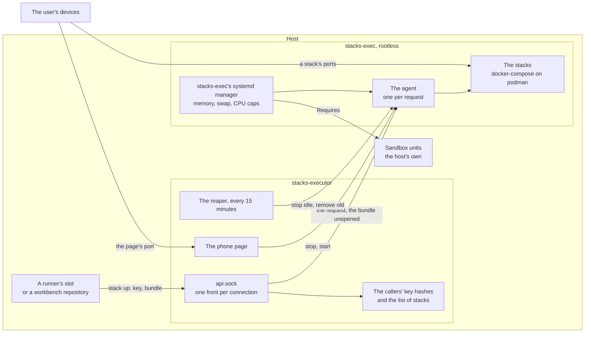

# executor

A server that runs compose stacks for its callers: the previews of the
[`github_runner`](github_runner.md)'s jobs and the
[`workbench`](workbench.md)'s sessions, and the end-to-end suites run
against them. A caller sends the checkout's HEAD as a git bundle and gets a
running stack on ports of its own. An instance has no Claude, no Claude
login and no GitHub credential, and the callers' code reaches it only as a
bundle and the words of a request.

## What is where



- **Two accounts, so what holds the keys never opens the code.**
  `<name>-executor` has no privileges and no podman. It answers the
  instance's socket, checks the caller's key against the SHA-256 the play
  wrote, keeps the list of stacks and the instance's limits, and hands the
  request with its bundle, unread, to the agent. `<name>-exec` is a
  [`rootless_account`](rootless_account.md): the agent, a user socket unit
  only the front's account reaches, checks the bundle out with hooks off and
  fsck on, refuses a compose file that asks for more than a stack may, and
  runs it with docker-compose on the account's podman.
- **The caller is the key's, never the request's.** Each caller has a key
  made on the host, which only root and the caller's own unit read, and
  the uid that may present it, checked with `SO_PEERCRED`. A caller has one
  stack and a block of ports that stays its own for as long as it is a
  caller, so its URL does not change between ups. As long as callers
  share an account and its podman socket, as a runner's slots share
  `coder`'s, the key tells them apart but does not protect them from each
  other: the boundary is the account.
- **What a stack may not ask for** the agent refuses, and says why:
  privileged containers, added capabilities, devices and GPUs, security
  options but `no-new-privileges`, another runtime or cgroup, the host's namespaces or another
  container's, bind mounts from outside the checkout and writable ones from
  inside it, builds that reach outside it or onto the host's network,
  volumes and networks not the stack's own, compose's own labels, and
  published ports not the caller's. It checks the services the stack
  starts, those of the compose profiles its profile turns on and no
  others, which are then not in the config it runs from at all. It reads
  the compose files with nothing of its
  account's but the stack's own directory in sight, so an `include`, an
  `extends` or an `env_file` cannot read another caller's tree.
- **What it checked is what runs.** The agent keeps the config it checked
  beside the tree and runs every later `start`, `run` and `logs` from it,
  never from the tree's files, which a container could rewrite. It drops
  fixed `container_name`s and healthchecks' `start_interval`, which compose
  on podman does not take.
- **A refused up changes nothing.** The new tree is checked out and its
  config checked beside the stack; the stack is replaced only once both
  pass. A broken compose file or a refused mount leaves the last stack up,
  the one someone may be looking at, and says why.
- **Room is shared.** At `max_stacks` running, an up stops the stack idle
  longest, if it has been idle `evict_idle_minutes`. With nothing to stop, a
  runner's job waits up to `queue_timeout_minutes` and a person is refused
  at once; both get status 75 and go on without a stack. The disk cap
  removes unused images first, then refuses.
- **Stacks end by themselves.** The reaper stops a stack nobody has used
  for `idle_hours`, keeping its tree and volumes, and removes one brought
  up `max_age_hours` ago, and those of callers no longer registered. The
  phone page starts a stopped one again.

## What the host must provide

The stacks are unreviewed code, and the role does not sandbox them. It
refuses an instance with no `sandbox_units`, and `<name>-exec`'s systemd
manager requires them, so no stack runs while one is down.

The host's sandbox must hold:

- **Who:** `exec_uid` and the whole subordinate range from
  `exec_subuid_start`. A stack's container runs as a subordinate ID, not
  as `<name>-exec`. Both are pinned, so the sandbox can name them before
  the account exists.
- **Must reach:** the internet and DNS, for images and packages.
- **May answer from:** the instance's range, `ports_start + 2` to
  `ports_end`, the callers' blocks.
- **Must not reach:** anything else on the host, its LAN or its private
  network.

And for the instance's own ports:

- **The callers** reach a stack's ports from where they run: a runner's
  slot and a workbench's container through `host.containers.internal`.
- **The user's devices** reach the callers' blocks and the phone page,
  `ports_start + 1`, which anyone who reaches it can use to stop and start
  the stacks, never to bring one up. Keep both to the user's private
  network, and the page from the callers: a job that reaches it can stop
  another caller's stack. The page answers only when it is asked for by
  `host` and its port, the URL the callers print.
- **`ports_start` is reserved** for a remote instance's API, which this
  version does not have: nothing listens there.

The role also needs:

- **A subordinate range of its own**, which no other account's overlaps.
- **The callers' roles after it**: a runner's or a workbench's play
  registers its callers with an instance this role has already set up.

## Pausing

While `/etc/hostkit-executor/<name>/paused` exists, the instance takes no
up and no run, and answers status 75 as if it had no room; the running
stacks stay. `touch` it before maintenance, remove it after.

## A repository's `stack.toml`

At the repository's root, it says how the checkout comes up:

```toml
[profiles.default]
compose = ["compose.yaml"]          # the compose files, in the repository
compose_profiles = ["seed"]         # optional: compose profiles to turn on
page = 1                            # which of the caller's ports is the page
env = { WEB_PORT = "{port1}", API_PORT = "{port2}", BIND = "{bind}" }

[suites.e2e]                        # `stack run e2e`
service = "e2e"                     # a service of the compose files
command = ["pytest", "tests/e2e"]   # run in a new container of it
```

`env` becomes the stack's `.env`, which compose reads for the files'
`${...}` and which replaces the tree's own `.env`, so a service's
`env_file: .env` reads it too: `{port1}` to `{portN}` are the caller's
ports, `{bind}` the address to publish on and `{host}` where the user opens
the stack. A repository whose `.env` comes from `cp .env.example .env`
needs no change, only a profile that sets what it would. The services of a
compose profile not in `compose_profiles` are left out, checked or run by
nothing; a suite's service must be one of the stack's. A suite's container
reaches the stack's services by their names.
An instance's `overrides` can add or replace a repository's profiles from
the inventory.

## Variables

Required, per instance, with no usable default:

| Key                 | What it is                                                  |
| ------------------- | ----------------------------------------------------------- |
| `name`              | Letters and digits, at most 16: the accounts and the units  |
| `exec_uid`          | `<name>-exec`'s uid, which the sandbox names                |
| `exec_subuid_start` | The start of `<name>-exec`'s subordinate ID range           |
| `sandbox_units`     | The host's units that sandbox `<name>-exec` and its range   |
| `ports_start`       | Reserved for a remote API, unused yet; the page is the next |
| `ports_end`         | The last port of the callers' blocks                        |

The most used of the optional ones, per instance:

| Key                     | Default         | What it is                                  |
| ----------------------- | --------------- | ------------------------------------------- |
| `host`                  | the host's FQDN | Where the user opens a stack                |
| `ports_per_caller`      | `3`             | Ports in a caller's block                   |
| `max_stacks`            | `3`             | Stacks running at once                      |
| `memory_max`            | `4G`            | Memory of every stack and build at once     |
| `memory_swap_max`       | `512M`          | Swap on top of that. Leave it bounded       |
| `disk_max_gb`           | `20`            | Images and trees, past which an up refuses  |
| `evict_idle_minutes`    | `30`            | Idle this long, a stack can be stopped      |
| `queue_timeout_minutes` | `20`            | How long a runner's job waits for room      |
| `idle_hours`            | `12`            | Unused this long, a stack is stopped        |
| `max_age_hours`         | `72`            | Up this long, a stack is removed            |
| `overrides`             | none            | Profiles per repository, from the inventory |

Every variable is described in
[`roles/executor/defaults/main.yml`](../roles/executor/defaults/main.yml).

## A minimal playbook

```yaml
- name: The executor
  hosts: runners
  roles:
    - role: joonalai.hostkit.executor
      vars:
        executor_instances:
          - name: stacks
            exec_uid: 2101
            exec_subuid_start: 300000
            sandbox_units: [sandbox.service]
            ports_start: 9200
            ports_end: 9299
```

`sandbox.service` is the host's own and must be in place before this play.
The runner's and the workbench's plays come after it, with `executor: stacks` on the repositories whose stacks run here.

## Running it

```sh
systemctl list-units 'executor-stacks-*'
sudo -iu stacks-exec podman ps
```

A person can be a caller too, with the `stack` command from
`tasks_from: client` and a registration from `tasks_from: callers`.
