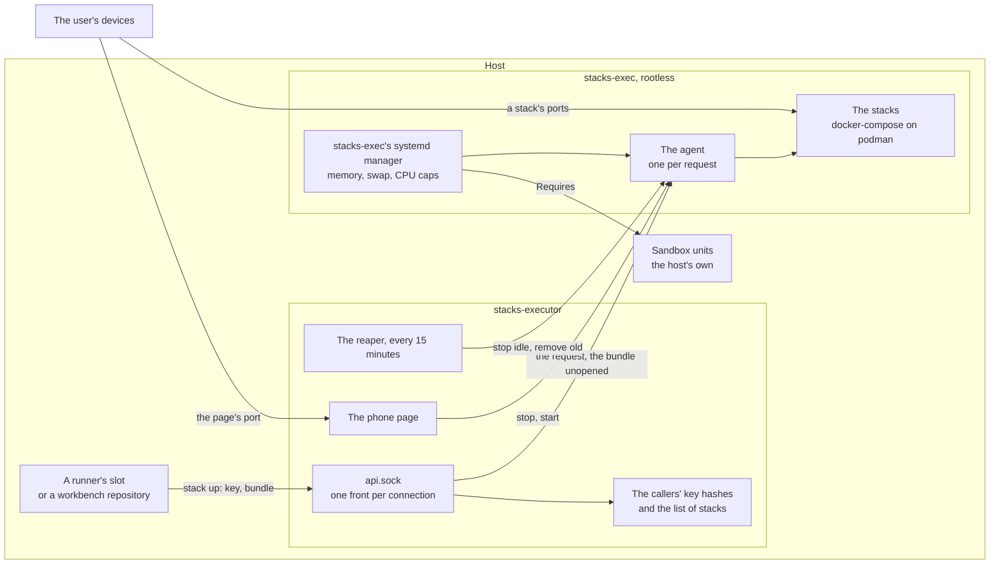

# executor

A server that runs compose stacks for its callers: the previews of the
[`github_runner`](github_runner.md)'s jobs and the
[`workbench`](workbench.md)'s sessions, and the end-to-end suites run
against them. A caller sends the checkout's HEAD as a git bundle and gets a
running stack on ports of its own. An instance has no Claude, no Claude
login and no GitHub credential, and the callers' code reaches it only as a
bundle and the words of a request.

## What is where



- **Two accounts, so what holds the keys never opens the code.**
  `<name>-executor` has no privileges and no podman. It answers the
  instance's socket, checks the caller's key against the SHA-256 the play
  wrote, keeps the list of stacks and the instance's limits, and hands the
  request with its bundle, unread, to the agent. `<name>-exec` is a
  [`rootless_account`](rootless_account.md): the agent, a user socket unit
  only the front's account reaches, checks the bundle out with hooks off and
  fsck on, refuses a compose file that asks for more than a stack may, and
  runs it with docker-compose on the account's podman.
- **The caller is the key's, never the request's.** Each caller has a key
  made on the host, which only root and the caller's own unit read, and
  the uid that may present it, checked with `SO_PEERCRED`. A caller has one
  stack and a block of ports that stays its own for as long as it is a
  caller, so its URL does not change between ups. As long as callers
  share an account and its podman socket, as a runner's slots share
  `coder`'s, the key tells them apart but does not protect them from each
  other: the boundary is the account.
- **What a stack may not ask for** the agent refuses, and says why:
  privileged containers, added capabilities, devices and GPUs, security
  options but `no-new-privileges`, another runtime or cgroup, the host's namespaces or another
  container's, bind mounts from outside the checkout and writable ones from
  inside it, builds that reach outside it or onto the host's network,
  volumes and networks not the stack's own, compose's own labels, another
  stack's image (`stack-...`, which it does not build itself), and
  published ports not the caller's. It checks the services the stack
  starts, those of the compose profiles its profile turns on and no
  others, which are then not in the config it runs from at all. It reads
  the compose files with nothing of its
  account's but the stack's own directory in sight, so an `include`, an
  `extends` or an `env_file` cannot read another caller's tree.
- **What it checked is what runs.** The agent keeps the config it checked
  beside the tree and runs every later `start`, `run` and `logs` from it,
  never from the tree's files, which a container could rewrite. It drops
  fixed `container_name`s and healthchecks' `start_interval`, which compose
  on podman does not take, and names every image the stack builds after
  the stack, whatever the compose file calls it: the instance's callers
  share one image store, and one could otherwise replace another's image.
- **A refused up changes nothing.** The new tree is checked out and its
  config checked beside the stack; the stack is replaced only once both
  pass. A broken compose file or a refused mount leaves the last stack up,
  the one someone may be looking at, and says why.
- **A stack keeps its data only on the same branch.** The last stack's
  volumes stay when the new commit is the last one or follows it, as when
  a job pushes more commits to its branch. A caller serves one job after
  another, so after another repository, another branch, an older commit,
  or a rebase or folded fix that rewrote the branch, whose last commit
  the bundle no longer carries, they are removed before the new stack
  starts, and a volume that will not go fails the up: its migrations and seed run on an
  empty database, never on one another branch's code made. The up says
  which (`volumes`: `kept` or `new`); a down gives a clean start any time.
- **An up waits for its stack.** It returns once every service runs,
  healthy where it has a healthcheck, or has ended with status 0, and has
  stayed so a few seconds, up to ten minutes. A service that exits with
  another status, restarts, is unhealthy or is not ready in time fails the
  up, which answers with the tail of that service's log and leaves the
  stack stopped and shown as failed, never as running while its page does
  not answer. A start from the phone page waits the same way, and starts a
  failed stack again; until it answers, the caller's own requests are
  refused as for any request of its still running.
- **Room is shared.** At `max_stacks` running, an up stops the runner's
  stack idle longest, if it has been idle `evict_idle_minutes`. With
  nothing to stop, a runner's job waits up to `queue_timeout_minutes` and a
  person is refused at once; both get status 75 and go on without a stack.
  The disk cap removes unused images first, then refuses.
- **A person's stack holds its place.** A caller that does not wait, a
  workbench's repository, is someone looking at its page, which the
  executor cannot see. Its stack is never stopped for another; it holds
  its place until its `down`, or until the reaper stops it after
  `idle_hours`. People's stacks take at most `max_stacks - waiting_reserve`
  places, and a person past that is refused at once with what holds them.
  Where runners share an instance with people, `waiting_reserve: 1` keeps
  a place a job always gets, at once or by stopping another runner's.
- **One service stops for a try.** `stack stop <service>` stops one
  service of the caller's running stack, a database for example, to try
  the page's error state, and `stack start <service>` starts it again,
  with compose's `start`: that service only, from the checked config, so
  nothing the stack was not checked with starts. The stack stays running,
  and `stack list` and the phone page name the services stopped. An up, or
  a start of the whole stack from the phone page, starts them all again.
- **Stacks end by themselves.** The reaper stops a stack nobody has used
  for `idle_hours`, keeping its tree and volumes, and removes one brought
  up `max_age_hours` ago, and those of callers no longer registered. The
  phone page starts a stopped one again.

## What the host must provide

The stacks are unreviewed code, and the role does not sandbox them. It
refuses an instance with no `sandbox_units`, and `<name>-exec`'s systemd
manager requires them, so no stack runs while one is down.

The host's sandbox must hold:

- **Who:** `exec_uid` and the whole subordinate range from
  `exec_subuid_start`. A stack's container runs as a subordinate ID, not
  as `<name>-exec`. Both are pinned, so the sandbox can name them before
  the account exists.
- **Must reach:** the internet and DNS, for images and packages.
- **May answer from:** the instance's range, `ports_start + 2` to
  `ports_end`, the callers' blocks.
- **Must not reach:** anything else on the host, its LAN or its private
  network.

And for the instance's own ports:

- **The callers** reach a stack's ports from where they run: a runner's
  slot and a workbench's container through `host.containers.internal`.
- **The user's devices** reach the callers' blocks and the phone page,
  `ports_start + 1`, which anyone who reaches it can use to stop and start
  the stacks, never to bring one up. Keep both to the user's private
  network, and the page from the callers: a job that reaches it can stop
  another caller's stack. The page answers only when it is asked for by
  `host` and its port, the URL the callers print.
- **`ports_start` is the TLS port** of a remote instance (`remote: true`),
  and nothing listens there otherwise. Let only the callers' hosts reach
  it, and their sandboxed accounts. The callers' blocks are theirs to
  reach as well, for the URLs `stack` prints. The phone page,
  `ports_start + 1`, stays off the callers' hosts as it stays off a local
  job: it can stop any caller's stack.

Where the stacks need a secure context, a passkey's for example, the host
can put HTTPS in front of each caller's page and set `https_port`. Its
proxy, which this role does not configure:

- **Listens with HTTPS** on the `https_port`-th port of every caller's
  block, on the addresses the user's devices reach, with a certificate
  for `host`, such as a private network's own (Tailscale Serve on a
  `*.ts.net` name).
- **Forwards to the block's first port** on the host itself, plain HTTP.
  The agent refuses a profile whose `page` is not 1 there, and a stack
  that publishes the `https_port` itself, so the mapping is fixed per
  block whatever the profile.

The callers still reach the page with plain HTTP on its own port, the
URL `stack` prints as "From here".

The role also needs:

- **A subordinate range of its own**, which no other account's overlaps.
- **The callers' roles after it**: a runner's or a workbench's play
  registers its callers with an instance this role has already set up.

## A remote instance

Callers on another host reach an instance over TLS on `ports_start`, with
the same requests as on the socket. Nothing secret passes between the two
hosts' inventories, which may be different people's:

- **The instance's certificate is its own.** With `remote: true` and no
  `tls_cert`, the play makes a self-signed key and certificate of ten
  years on the instance's host, the key readable by the front's account
  alone, and prints the certificate's SHA-256. The callers pin that hash,
  so its name and its age do not matter. To replace it, remove
  `tls.crt` and `tls.key` from `/etc/hostkit-executor/<name>/`, run the
  play, and copy the new hash to every callers' host; until then they
  refuse to connect. `tls_cert` and `tls_key` take your own pair instead,
  paths on the host the front's account can read.
- **A caller's key stays on the callers' host.** That host's play makes
  it, as it does for a local instance, and prints the caller's name and
  the key's SHA-256. The instance registers the caller by that hash.
- **The key is taken only from where the caller is.** A remote caller's
  `from` lists the addresses or networks it connects from, and its key
  is refused from anywhere else, and on the local socket. A local
  caller's key is refused on the TLS port. The host's firewall, letting
  only the callers' hosts reach `ports_start`, is the boundary; `from` is
  the second check.
- **A stalled request is cut off.** Each read of a request and of its
  bundle waits a minute at most, and one host holds at most four
  connections at once.

So connecting the two takes four public values, copied by hand:

```yaml
# The instance's host.
executor_instances:
  - name: stacks
    # ...
    remote: true
    remote_callers:                 # what the callers' play printed
      - name: remote-ci-runner-app-1
        key_sha256: <64 hex>
        repos: [example/app]
        waits: true
        from: [192.0.2.20]          # the one thing to add by hand

# The callers' host: a runner's or a workbench's repository names the
# instance with `executor: stacks` as it would a local one.
executor_remote_instances:
  - name: stacks
    url: tls://stacks.example.ts.net:9200
    tls_sha256: <64 hex>            # what the instance's play printed
```

A caller's name on the callers' host is its role's, `runner-<slot>` or
`bench-<name>`; on the instance it is `remote-` and
anything, which the instance's play removes once it is no longer listed.
The callers' play prints each one's entry ready to paste, named
`remote-<host>-<caller>` after its inventory host, so two callers' hosts
never collide on one instance. The `stack` client
reads `STACK_URL` and `STACK_TLS_SHA256`, or `STACK_TLS_CA` for a
certificate a CA signed, in place of `STACK_SOCKET`, and checks the
certificate before it sends a byte.

## Pausing

While `/etc/hostkit-executor/<name>/paused` exists, the instance takes no
up and no run, and answers status 75 as if it had no room; the running
stacks stay. `touch` it before maintenance, remove it after.

## A repository's `stack.toml`

At the repository's root, it says how the checkout comes up:

```toml
[profiles.default]
compose = ["compose.yaml"]          # the compose files, in the repository
compose_profiles = ["seed"]         # optional: compose profiles to turn on
page = 1                            # which of the caller's ports is the page
env = { WEB_PORT = "{port1}", API_PORT = "{port2}", BIND = "{bind}" }

[suites.e2e]                        # `stack run e2e`
service = "e2e"                     # a service of the compose files
command = ["pytest", "tests/e2e"]   # run in a new container of it
```

`env` becomes the stack's `.env`, which compose reads for the files'
`${...}` and which replaces the tree's own `.env`, so a service's
`env_file: .env` reads it too: `{port1}` to `{portN}` are the caller's
ports, `{bind}` the address to publish on, `{host}` where the user opens
the stack, and `{url}` the page's origin as the user opens it:
`http://{host}:{portN}` with `N` the `page`, or `https://{host}:{portN}`
with `N` the instance's `https_port` where its host serves HTTPS in front
of the page. A profile that uses `{url}`, for an app's public URL or a
passkey's origin, is right on both kinds of instance. A repository whose `.env` comes from `cp .env.example .env`
needs no change, only a profile that sets what it would. The services of a
compose profile not in `compose_profiles` are left out, checked or run by
nothing; a suite's service must be one of the stack's. A suite's container
reaches the stack's services by their names.
The checkout has git's usual modes whatever the agent's umask, files
`0644` and executables `0755`, so an image's `COPY` of them stays readable
by a service that does not run as root.
An instance's `overrides` can add or replace a repository's profiles from
the inventory.

### Secrets

A value the repository must not hold, such as a key for a service the
host's sandbox lets the stacks reach, comes from the instance. The
profile names it with `{secret:<name>}`, and the instance's `secrets`
decide which repository is given which:

```yaml
# The consumer's inventory: the values from its vault.
executor_instances:
  - name: stacks
    # ...
    secrets:
      values:
        model_key: "{{ vault_stacks_model_key }}"
      repositories:
        example/app: [model_key]
```

```toml
[profiles.default]
compose = ["compose.yaml"]
env = { MODEL_API_KEY = "{secret:model_key}" }
```

```yaml
# compose.yaml: the service takes it by name.
services:
  api:
    environment:
      MODEL_API_KEY: ${MODEL_API_KEY}
```

- **Only for the files' `${...}`.** A value holding a secret is in the
  stack's env that compose reads, never in the tree's `.env`. The tree is
  the build's context and a service's to bind-mount, so a service's
  `env_file: .env` does not get it, and a `COPY .` does not put it in an
  image. A build that holds one, in an arg, a label, an inline
  Dockerfile or anywhere else, is refused: it would stay in the image and
  its build cache, which every caller of the instance builds in.
- **A secret not given is empty.** The up names the secrets that were left
  empty, never a value. A stack still comes up on an instance that gives
  its repository nothing, a workstation's or a test container's, and only
  the part that needs the service fails.
- **Names, not values, in what the callers see.** Wherever the up, a
  suite, the logs or a refusal would print a value given to the stack,
  the instance prints `{secret:<name>}`, and the journal does the same.
  This catches a value printed by mistake. A service that encodes it
  first gets past it.
- **Suites get the same values.** A suite's container is a new container
  of one of the stack's services, with the same environment.
- **A change takes effect at the next up.** A start from the phone page
  runs the stack as it was brought up. To take a value back at once,
  `down` the stacks that hold it; the reaper removes every stack after
  `max_age_hours` anyway.

#### Who can read a secret

A secret given to a repository is given to everyone who can bring that
repository up on the instance: every caller whose registration lists the
repository. The caller sends the code that runs with the value, so one
line that prints it encoded, then `stack logs`, hands it over. The
instance keeps the value off the forge, out of the play's output and away
from other repositories' stacks. It does not keep it from the callers of
the repository it is given to.

So give a stack only a value you would give those callers anyway. Make it
a key of its own on the far side, which can be revoked alone, with a rate
limit there if the service has one.

### Keeping its build cheap

Every up builds the stack's images on a host that may be small and busy,
one image at a time, and keeps the layers between ups. What a repository
can do so that a change rebuilds only what it changed:

- **Dependencies before the source.** Copy the manifest and the lock file
  alone, install from them, then copy the rest: `uv sync --frozen --no-install-project` (`--no-install-workspace` in a workspace) before
  the source and `uv sync --frozen` after it, or `bun install --frozen-lockfile` before copying the app. A Containerfile that copies
  the source first downloads every package again on every change.
- **One build for the services that run one image**: a YAML anchor they
  all take, or one service's `build:` and `image:` whose name the others
  run. They are built one after another, so all but the first are cache
  hits.

## Variables

Required, per instance, with no usable default:

| Key                 | What it is                                                 |
| ------------------- | ---------------------------------------------------------- |
| `name`              | Letters and digits, at most 16: the accounts and the units |
| `exec_uid`          | `<name>-exec`'s uid, which the sandbox names               |
| `exec_subuid_start` | The start of `<name>-exec`'s subordinate ID range          |
| `sandbox_units`     | The host's units that sandbox `<name>-exec` and its range  |
| `ports_start`       | A remote instance's TLS port; the page is the next         |
| `ports_end`         | The last port of the callers' blocks                       |

The most used of the optional ones, per instance:

| Key                     | Default         | What it is                                                                   |
| ----------------------- | --------------- | ---------------------------------------------------------------------------- |
| `host`                  | the host's FQDN | Where the user opens a stack                                                 |
| `ports_per_caller`      | `3`             | Ports in a caller's block                                                    |
| `https_port`            | none            | The block's port the host serves the page on with HTTPS, 2 or more           |
| `max_stacks`            | `3`             | Stacks running at once                                                       |
| `waiting_reserve`       | `0`             | Places people's stacks leave to runners' jobs; `1` where they share          |
| `memory_max`            | `4G`            | Memory of every stack and build at once                                      |
| `memory_swap_max`       | `512M`          | Swap on top of that. Leave it bounded                                        |
| `cpu_quota`             | none            | CPU time of every stack and build at once                                    |
| `cpu_weight`            | none            | Their share against the host's other accounts; `20` lets a runner's jobs win |
| `remote`                | `false`         | The TLS port on `ports_start`, for callers on other hosts                    |
| `remote_callers`        | none            | Callers on other hosts, by their key's hash and their addresses              |
| `disk_max_gb`           | `20`            | Images and trees, past which an up refuses                                   |
| `evict_idle_minutes`    | `30`            | Idle this long, a runner's stack can be stopped                              |
| `queue_timeout_minutes` | `20`            | How long a runner's job waits for room                                       |
| `idle_hours`            | `12`            | Unused this long, a stack is stopped                                         |
| `max_age_hours`         | `72`            | Up this long, a stack is removed                                             |
| `overrides`             | none            | Profiles per repository, from the inventory                                  |
| `secrets`               | none            | Values the stacks of chosen repositories get                                 |

Every variable is described in
[`roles/executor/defaults/main.yml`](../roles/executor/defaults/main.yml).

## A minimal playbook

```yaml
- name: The executor
  hosts: runners
  roles:
    - role: joonalai.hostkit.executor
      vars:
        executor_instances:
          - name: stacks
            exec_uid: 2101
            exec_subuid_start: 300000
            sandbox_units: [sandbox.service]
            ports_start: 9200
            ports_end: 9299
```

`sandbox.service` is the host's own and must be in place before this play.
The runner's and the workbench's plays come after it, with `executor: stacks` on the repositories whose stacks run here.

## Running it

```sh
systemctl list-units 'executor-stacks-*'
sudo -iu stacks-exec podman ps
```

A caller's request that the instance refuses or that fails, and a stop or
start from the phone page that does, leaves a line in the journal, with
the caller, the action and what the caller was told:

```sh
journalctl -u 'executor-stacks-front@*'
```

A person can be a caller too, with the `stack` command from
`tasks_from: client` and a registration from `tasks_from: callers`, as
`dev/smoke.yml` does in the dev container.
