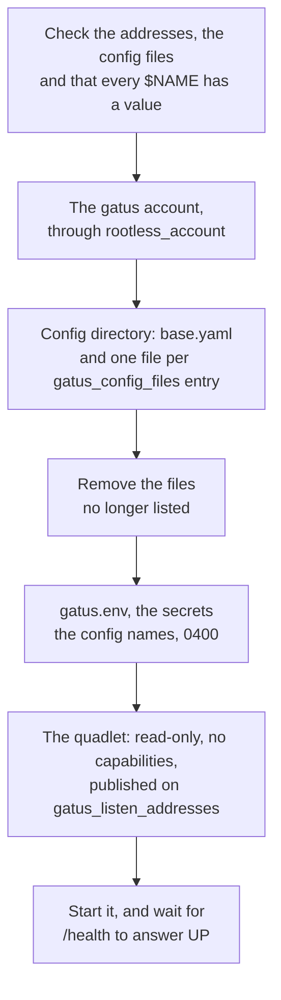
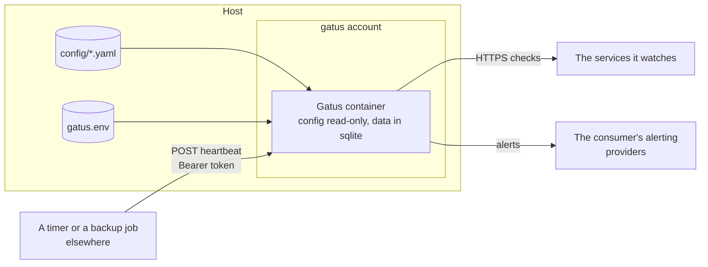

# gatus

Runs [Gatus](https://github.com/TwiN/gatus) (Apache 2.0), a health checker
with a dead man's switch, as a rootless container in an account of its own.
Everything it checks and where it alerts comes from the consumer's
inventory, one config file per concern. The role adds only where Gatus
listens and where it keeps its history.

## What it sets up





- **Each concern in a file of its own.** Gatus merges every file in its
  config directory: maps are merged deeply and lists, such as `endpoints`
  and `external-endpoints`, appended. A value that is not a list or a map
  may be set only once across them. The role's own `base.yaml` sets the
  port inside the container and the sqlite store, so the consumer's files
  leave `web` and `storage` alone.
- **Secrets go in as `${NAME}`.** Gatus fills `$NAME` and `${NAME}` from its
  environment, which the role writes from `gatus_environment` to a file only
  the account reads. The config files then diff like any other, and hold no
  token. A name the config uses with no value fails the play rather than
  leave a token empty. Write a literal dollar sign as `$$`.
- **A file no longer listed is removed,** since Gatus would keep its checks.
- **Gatus refuses to start with nothing to check,** so the role refuses a
  config without `endpoints`, `external-endpoints` or `suites`, and after
  every start waits for `/health` to answer rather than trust the unit.
- **Its history survives a restart,** in sqlite under the account's `data`.
  A changed file or secret restarts it.

## What the host provides

- **The firewall,** which this role never touches. Gatus is published on
  `gatus_listen_addresses` at `gatus_port`, loopback alone by default. A
  heartbeat from another machine needs an address it reaches there, such
  as the host's LAN or tailnet address, and the host's firewall opening the
  port from those machines alone. Anyone who reaches the port can read the
  status page and its API. A heartbeat needs its endpoint's token.
- **Outbound access** to what it checks and to its alerting providers.

## Variables

| Variable                 | Default           | What it is                                                          |
| ------------------------ | ----------------- | ------------------------------------------------------------------- |
| `gatus_user`             | `gatus`           | The account                                                         |
| `gatus_uid`              | empty             | Its uid, pinned where the host's firewall names it                  |
| `gatus_subuid_start`     | empty, required   | The start of its subordinate ID range                               |
| `gatus_subuid_count`     | `65536`           | Its size                                                            |
| `gatus_sandbox_units`    | `[]`              | Host units the account's manager `Requires=`, as rootless_account   |
| `gatus_image`            | pinned by digest  | The Gatus image                                                     |
| `gatus_listen_addresses` | `[127.0.0.1]`     | The host addresses the port is published on                         |
| `gatus_port`             | `8080`            | The host's port                                                     |
| `gatus_config_files`     | `{}`, required    | name to the YAML of one config file, as a mapping                   |
| `gatus_environment`      | `{}`              | `NAME` to the secret the config names as `${NAME}`                  |
| `gatus_base_config`      | port 8080, sqlite | The role's own file, `base.yaml`                                    |
| `gatus_memory_max`       | `256M`            | systemd's `MemoryMax` on the container                              |
| `gatus_start`            | `true`            | `false` writes everything and leaves it stopped, with no boot start |

Each is described in full in
[`roles/gatus/defaults/main.yml`](../roles/gatus/defaults/main.yml).

## Using it

```yaml
- name: The checker
  hosts: checker
  roles:
    - role: joonalai.hostkit.gatus
      vars:
        gatus_uid: 2401
        gatus_subuid_start: 300000
        gatus_listen_addresses: [127.0.0.1, 192.0.2.10]
        gatus_config_files:
          alerting:
            alerting:
              homeassistant:
                url: http://192.0.2.5:8123
                token: ${HA_TOKEN}
                default-alert:
                  send-on-resolved: true
          app:
            endpoints:
              - name: front page
                group: app
                url: https://app.example.org/health
                interval: 1m
                conditions: ["[STATUS] == 200", "[RESPONSE_TIME] < 1000"]
                alerts: [{type: homeassistant, failure-threshold: 2}]
            external-endpoints:
              - name: deploy-timer
                group: app
                token: ${APP_DEPLOY_TIMER_TOKEN}
                heartbeat: {interval: 15m}
                alerts: [{type: homeassistant}]
        gatus_environment:
          HA_TOKEN: "{{ vault_ha_token }}"
          APP_DEPLOY_TIMER_TOKEN: "{{ vault_deploy_timer_token }}"
```

The timer then posts after each run, with its token:

```sh
curl -fsS -X POST -H "Authorization: Bearer $TOKEN" \
  "http://192.0.2.10:8080/api/v1/endpoints/app_deploy-timer/external?success=true"
```

The key in the path is the group and the name joined by `_`, with spaces
and `/ _ , . # + &` in them turned to `-`. `success=false&error=<text>`
reports a failure with its reason.

Two flags are read from the play, as rootless_account reads them:
`install_dependencies` and `is_container_environment`.
