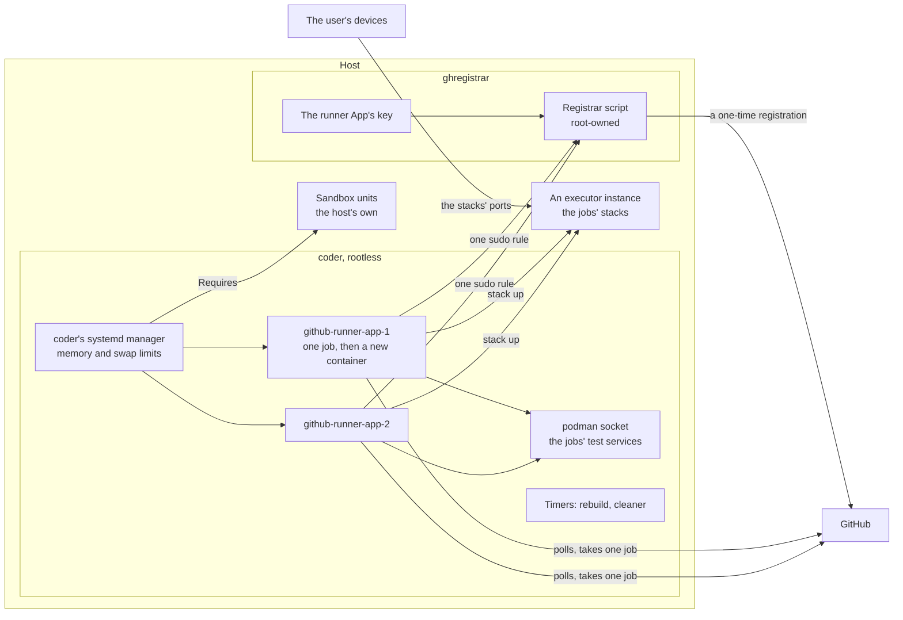
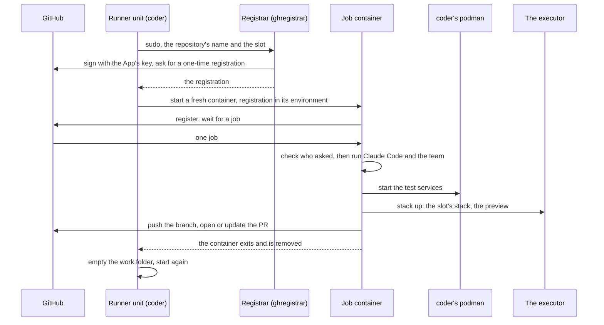

# github_runner

Self-hosted GitHub Actions runners for Claude Code to work issues on. Every
job gets a fresh rootless container with a single-use registration, and the
container is removed when the job ends. The runner dials out to GitHub and
polls for jobs, so it needs no open port.

For plain CI of private repositories, with no Claude in the job, see
[`ci_runner`](ci_runner.md).

## What is where



- **Two accounts, so a job cannot reach the key that registers runners.**
  The App's key is readable only by `ghregistrar`. `coder`, which runs the
  containers, reaches it through one sudo rule naming one root-owned
  script, and that script registers runners only for the listed
  repositories and slots.
- **One container per job, and the unit is the loop.** A runner takes one
  job and exits. The unit restarts, mints a new registration and starts a
  new container. Never restart the units by hand without checking: a
  restart kills the job in progress.
- **Slots, not repositories, are the unit.** Every repository has `runners`
  slots, and each slot has its own unit, registration, ports and rules.
- **The preview is the executor's.** A repository whose entry names an
  [`executor`](executor.md) instance has each slot registered as its
  caller, and a job brings the checkout up there with `stack up`.
- **The account is the boundary.** The jobs' test services run through
  `coder`'s podman socket, so a job can reach everything `coder` can. That
  is sound only while every repository served is the same owner's work,
  has no outside contributors, and what runs in a job is vouched for.
- **The team** the jobs call is [`claude_team`](claude_team.md)'s, mounted
  read only. A repository can opt into further skills and add its own
  instructions from the inventory.
- **The image is rebuilt every night, afresh every week,** so Debian's
  security updates reach it.

## A job



## Previews

A job's preview is the slot's stack on an [`executor`](executor.md)
instance on the same host, which the repository's entry names. `stack up`
in the job sends the checkout's HEAD as a git bundle; the instance builds
it from the repository's `stack.toml` and starts it on the slot's ports of
its own range, and prints the URL the user opens. The stack stays up until
the slot's next `stack up`, or until nobody has used it for the instance's
idle hours; its phone page starts a stopped one again. A repository with
no executor has no preview.

The jobs keep coder's podman socket for the test services they start
themselves, on the slot's own ports, which only the job reaches.

## What the host must provide

The jobs are unreviewed code, and the role does not sandbox them. The role
refuses to run until `github_runner_sandbox_units` names the units of the
host's own hardening, and `coder`'s systemd manager then requires them, so
no job runs while one is down.

The host's sandbox must hold:

- **Who:** `github_runner_uid` and the whole subordinate range from
  `github_runner_subuid_start`. A service on the host's network runs as a
  subordinate ID, not as `coder`. Both are pinned, so the sandbox can name
  them before the account exists.
- **Must reach:** the internet, DNS, and the stack range of each executor
  instance its repositories name.
- **May answer from:** the slots' ports,
  `github_runner_preview_ports_start` to `github_runner_preview_ports_end`.
- **Must not reach:** anything else on the host, its LAN or its private
  network. The one exception is the GPU model server, where a repository
  opts into `gpu-models`.

Test a sandbox with everything a job can do: plain `coder`, a job container,
a host-network service, and a port outside the range. All should be
refused, except the slot's own ports, the executor's stacks and the internet.

The role also needs:

- **A GitHub App that registers runners**, with Administration read and
  write on repositories and nothing else, installed only on the
  repositories served. Not the App Claude acts as, whose key a job can read.
- **A workflow in each repository served** that runs Claude Code on the
  runners' label. Its steps are scripts in the image, named
  `claude-job-*`.
- **A subordinate range of its own**, which no other account's overlaps.
- **The executor role first**, where a repository names an instance: the
  play registers the slots with it.

## Variables

Required, with no usable default:

| Variable                        | What it is                                                    |
| ------------------------------- | ------------------------------------------------------------- |
| `github_runner_sandbox_units`   | The host's units that sandbox `coder` and its range           |
| `github_runner_uid`             | `coder`'s uid, which the sandbox names                        |
| `github_runner_subuid_start`    | The start of `coder`'s subordinate ID range                   |
| `github_runner_app_id`          | The runner App's ID                                           |
| `github_runner_app_private_key` | The runner App's key, from the consumer's secret store        |
| `github_runner_repos`           | The repositories served. Empty installs and registers nothing |

An entry of `github_runner_repos`:

```yaml
github_runner_repos:
  - name: app
    repo: example/app
    port_base: 9100
    runners: 3            # optional
    instructions: |       # optional, Markdown for everyone in its jobs
      - How its preview wants starting.
    skills: [gpu-models]  # optional
    executor: stacks      # optional: the executor instance of its previews
    rebase_runner: true   # optional: one more slot, for rebases alone
```

The most used of the optional ones:

| Variable                                | Default        | What it is                                                              |
| --------------------------------------- | -------------- | ----------------------------------------------------------------------- |
| `github_runner_runners`                 | `3`            | Runners per repository, unless its entry says otherwise                 |
| `github_runner_bot`                     | `claude`       | The bot's name: what a comment mentions, and what the labels begin with |
| `github_runner_labels`                  | the bot's name | What a workflow's `runs-on` names, besides `self-hosted`                |
| `github_runner_memory_max`              | `3G`           | Memory of one job                                                       |
| `github_runner_cpu_quota`               | `200%`         | CPU time of one job                                                     |
| `github_runner_account_memory_max`      | `5G`           | Memory of everything `coder` runs, test services included               |
| `github_runner_account_memory_swap_max` | `512M`         | Swap on top of that. Leave it bounded                                   |
| `github_runner_preview_ports_start`     | `9100`         | The first port the jobs' test services may publish                      |
| `github_runner_preview_ports_end`       | `9199`         | The last                                                                |
| `github_runner_strays_max_age_hours`    | `12`           | A container a job left outside any compose project goes after this long |
| `github_runner_cache_max_gb`            | `5`            | A repository's dependency cache is emptied past this                    |
| `github_runner_version`                 | `latest`       | The Actions runner's version                                            |
| `github_runner_image_packages`          | a few          | Debian packages baked into the image for the jobs                       |
| `github_runner_start`                   | `true`         | `false` in a test container, which starts nothing                       |

Every variable is described in
[`roles/github_runner/defaults/main.yml`](../roles/github_runner/defaults/main.yml).

## A minimal playbook

```yaml
- name: Claude's runners
  hosts: runners
  roles:
    - role: joonalai.hostkit.github_runner
      vars:
        github_runner_sandbox_units: [sandbox.service]
        github_runner_uid: 2001
        github_runner_subuid_start: 165536
        github_runner_app_id: "{{ vault_github_runner_app_id }}"
        github_runner_app_private_key: "{{ vault_github_runner_app_private_key }}"
        github_runner_repos:
          - name: app
            repo: example/app
            port_base: 9100
```

`sandbox.service` is the host's own and must be in place before this play.

## Running it

As `coder`, with `sudo -iu coder`:

```sh
systemctl --user list-units 'github-runner-*'
journalctl --user -u github-runner-app-1
```

A host that monitors the runners should count `Runner.Listener` processes
of `coder` and alert when fewer listen than the slots set up.
`Runner.Worker` counts the running jobs. A runner that cannot register
loops every ten seconds with the reason in its journal.
