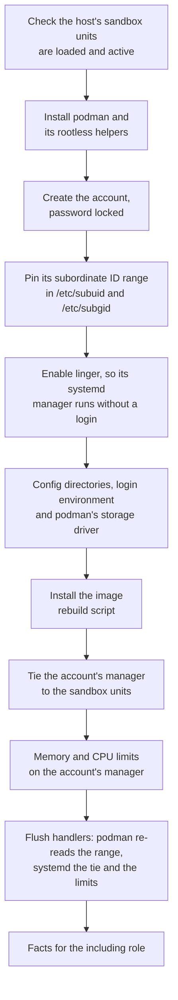
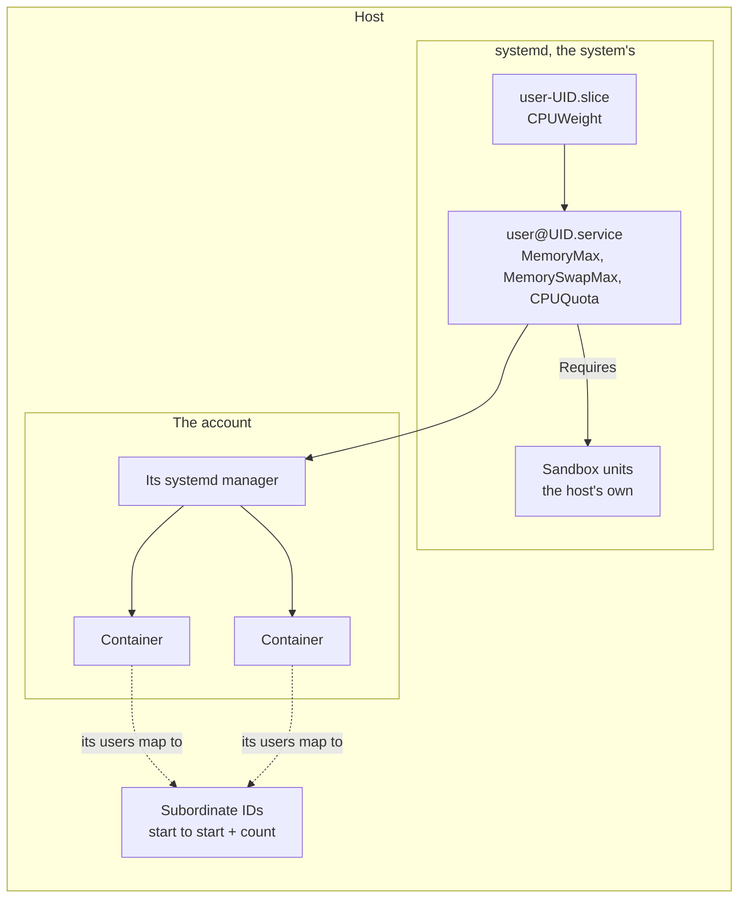

# rootless_account

Makes an account that runs rootless podman containers from its own systemd
manager. Other roles include it, once for each account they need. It can
also be used on its own.

## What it sets up



- **The range is pinned,** not left to `useradd`: the account's containers
  run as those IDs on the host, so the host's sandbox may have to name them.
- **Linger** keeps the account's manager, and so its containers, running
  after a reboot though nothing logs in as the account.
- **The sandbox is the host's.** With `rootless_account_sandbox_units` set,
  the role fails before it makes the account if one of the units is not
  loaded and active, and makes the account's
  manager require them: it does not start without them and stops when one
  stops. With none, it removes the tie.
- **The limits** are a drop-in on `user@<uid>.service` and so hold every
  container and process the account runs.
- **The rebuild script** builds an account's image from a config the play
  writes, afresh once a week, for the including role to run from the play
  and from a timer of its own.

## Where the account's containers run



## What the host must provide

Debian with systemd, and a subordinate ID range that no other account
uses. The role does not sandbox the account, and never changes the firewall:
the host's own hardening provides the units named in
`rootless_account_sandbox_units`. A role that runs untrusted code in the
account says what those units must hold off, and refuses an empty list
itself, as `ci_runner`, `github_runner` and `workbench` do.

## Variables

Required:

| Variable                        | What it is                                      |
| ------------------------------- | ----------------------------------------------- |
| `rootless_account_user`         | The account's name                              |
| `rootless_account_subuid_start` | The start of the account's subordinate ID range |

Optional:

| Variable                           | Default                            | What it is                                                   |
| ---------------------------------- | ---------------------------------- | ------------------------------------------------------------ |
| `rootless_account_uid`             | the system's choice                | Pin it when the host's hardening names the account by number |
| `rootless_account_home`            | `/home/<user>`                     | The account's home                                           |
| `rootless_account_subuid_count`    | `65536`                            | The size of the range                                        |
| `rootless_account_create`          | `true`                             | `false` when another role owns the account, linger and shell |
| `rootless_account_memory_max`      | none                               | Memory of everything the account runs                        |
| `rootless_account_memory_swap_max` | none                               | How much of that may sit in swap                             |
| `rootless_account_cpu_quota`       | none                               | CPU time of everything the account runs, `200%` is two cores |
| `rootless_account_cpu_weight`      | none                               | Its share of the CPU against the other accounts, 1 to 10000  |
| `rootless_account_sandbox_units`   | `[]`                               | The host's units the account's manager requires              |
| `rootless_account_profile_marker`  | `rootless_account`                 | The marker of the block written to the account's `.profile`  |
| `rootless_account_rebuild_bin`     | `/usr/local/libexec/rebuild-image` | Where the image rebuild script is installed                  |

The quota and the weight do different things. The quota is a ceiling: it
holds even when the host is idle, and a build waits for no one. The
weight counts only when accounts compete: an account weighted 20 gets a
fifth of what one at systemd's 100 gets, and all of the CPU when the
other is idle. To keep a host's CI fast while the stacks build, give the
stacks a low weight and a generous quota. The weight is on the account's
`user-<uid>.slice`, so it weighs the account against the host's other
accounts. The host's system services are in `system.slice`, beside
`user.slice`, and no account's weight moves them; that is the host's own
setting.

Two flags are read from the play: `install_dependencies`, `false` to skip
the `apt` task, and `is_container_environment`, `true` in a test container,
which switches podman to the userspace overlay driver.

Each is described in full in
[`roles/rootless_account/defaults/main.yml`](../roles/rootless_account/defaults/main.yml).

## Using it

```yaml
- name: Create the account
  ansible.builtin.include_role:
    name: joonalai.hostkit.rootless_account
  vars:
    rootless_account_user: runner
    rootless_account_uid: 2001
    rootless_account_subuid_start: 165536
    rootless_account_memory_max: 4G
    rootless_account_sandbox_units: [sandbox.service]
```

The role leaves these facts, which the including role copies into names of
its own before another account's include overwrites them:

| Fact                             | What it is                                                       |
| -------------------------------- | ---------------------------------------------------------------- |
| `rootless_account_env`           | `XDG_RUNTIME_DIR` and `DBUS_SESSION_BUS_ADDRESS` for the account |
| `rootless_account_runtime_dir`   | `/run/user/<uid>`                                                |
| `rootless_account_rebuild_image` | The path of the image rebuild script                             |

Every task that runs as the account carries the environment itself, since
`become` opens no login session:

```yaml
- name: List the account's containers
  ansible.builtin.command: podman ps
  changed_when: false
  become: true
  become_user: runner
  environment: "{{ rootless_account_env }}"
```
