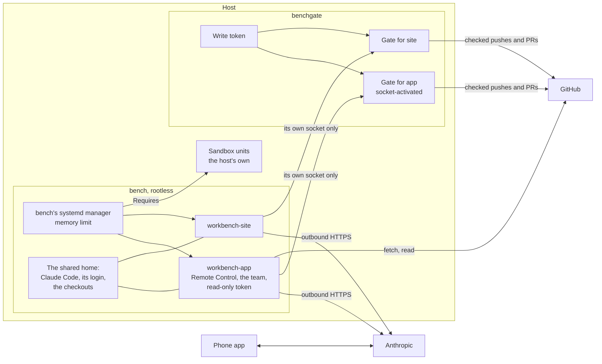
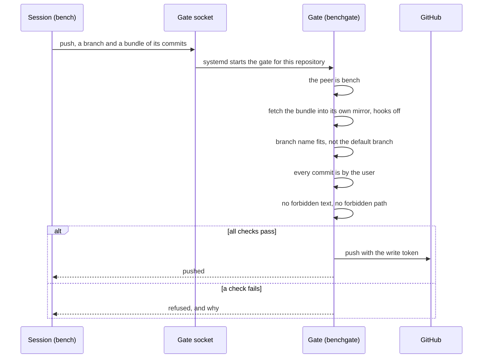

# workbench

Claude's team in a checkout on the host, driven from a phone through Remote
Control, leaving on GitHub nothing but the user's own commits and PRs. A
container per repository runs the repository's Remote Control server, and
everything written to GitHub goes through a gate.

The runner is the other way in, for work whose conversation belongs on
GitHub: [`github_runner`](github_runner.md).

## What is where



- **Two accounts, so what a session can run and what can write to GitHub
  are not the same thing.** `bench` runs the containers and holds a
  read-only token. `benchgate` holds the write token and runs the gate.
- **The repository is the socket's.** Each repository has a socket of its
  own, mounted into that repository's container alone. The client sends
  only an action and its arguments, never a repository's name.
- **The container is for ease, the account is the boundary.** Every
  container mounts the whole home. What fences a session is the host's
  sandbox around `bench` and its range, and the gate.
- **Parallel sessions are git worktrees,** `workbench_capacity` at once per
  repository.
- **Claude Code** is the [`claude_code`](claude_code.md) role's, and the
  team is [`claude_team`](claude_team.md)'s.
- **The image is rebuilt every night, afresh every week.** A container
  moves onto a new image only while no session is open in it.

## A push through the gate



What the gate holds to:

- **Branches only**, by `workbench_branch_pattern`. Never the default
  branch, never a tag.
- **The user's commits only**: any commit by anyone but
  `workbench_git_email` is refused.
- **No trace of the workbench**: no message or PR text matching
  `workbench_forbidden`, no commit touching `workbench_forbidden_paths`.
- **`--force` replaces only what the gate itself pushed**, and only while
  GitHub still has exactly that commit.
- **A public repository's PR opens as a draft.** Marking it ready is the
  user's, on GitHub.
- **Workflow files need a token of their own**, used only for a repository
  with `workflows: true` and only for a push that touches a workflow.
- **The token is never an argument**, and the gate never runs git in the
  workbench's checkout.

## What the host must provide

The sessions run whatever a session decides to. The role does not sandbox
them, and refuses to run until `workbench_sandbox_units` names the units of
the host's own hardening. `bench`'s systemd manager then requires them, so
every session and container stops with them.

The host's sandbox must hold:

- **Who:** `workbench_uid` and the whole subordinate range from
  `workbench_subuid_start`. The range matters as much as the uid: any user
  but root in a container runs as one of those IDs.
- **Must reach:** the internet, and DNS.
- **May answer from:** the preview ports, one per repository from
  `workbench_preview_ports_start`.
- **Must not reach:** anything else on the host, its LAN or its private
  network.

The role also needs:

- **A Claude subscription login** for the account, done once by a person,
  as [`claude_code`](claude_code.md) says.
- **Two fine-grained tokens of the user's**, for the workbench's
  repositories only. Read: Contents, Pull requests and Issues, read. Write:
  Contents and Pull requests, read and write. Neither gets Workflows. A
  third, optional, adds Workflows for the repositories that ask for it.
- **A play of its own**, with the account as play vars, so `claude_code`
  installs for `bench` and not for its default account.

What a session can still do: send out what it can read, and run code in CI
with a repository's secrets, since its branches are the repository's own.

## Variables

Required, with no usable default:

| Variable                  | What it is                                                      |
| ------------------------- | --------------------------------------------------------------- |
| `workbench_sandbox_units` | The host's units that sandbox `bench` and its range             |
| `workbench_uid`           | `bench`'s uid, which the sandbox names                          |
| `workbench_subuid_start`  | The start of `bench`'s subordinate ID range                     |
| `workbench_git_name`      | Who the commits are by                                          |
| `workbench_git_email`     | Their address, such as the noreply one GitHub gives the account |
| `workbench_read_token`    | The read token, from the consumer's secret store                |
| `workbench_write_token`   | The write token, readable by the gate alone                     |
| `workbench_repositories`  | The repositories worked in. Empty, the play does nothing        |

An entry of `workbench_repositories`:

```yaml
workbench_repositories:
  - name: app
    repo: example/app
    default_branch: main   # optional
    packages: [ffmpeg]     # optional, Debian packages added to the image
    workflows: true        # optional, needs workbench_workflow_token
    instructions: |        # optional, Markdown for its sessions
      - What its dev server needs here.
    executor: stacks       # optional: the executor instance of its stacks
```

A repository that names an [`executor`](executor.md) instance is its
caller, `bench-<name>`: its sessions bring the checkout's HEAD up there
with `stack up`, as the `preview` skill says, on ports of its own. A person
drives the sessions, so an up with no room is refused at once. The
executor's play must come before the workbench's.

The most used of the optional ones:

| Variable                         | Default                   | What it is                                                   |
| -------------------------------- | ------------------------- | ------------------------------------------------------------ |
| `workbench_user`                 | `bench`                   | The account the containers run as                            |
| `workbench_gate_user`            | `benchgate`               | The account that holds the write token                       |
| `workbench_memory_max`           | `2G`                      | Memory of everything `bench` runs                            |
| `workbench_cpu_weight`           | none                      | Its share of the CPU against the other accounts, 1 to 10000  |
| `workbench_container_memory_max` | `1536M`                   | Memory of one repository's container                         |
| `workbench_capacity`             | `3`                       | Sessions at once per repository                              |
| `workbench_workflow_token`       | none                      | The token for pushes that touch a workflow                   |
| `workbench_branch_pattern`       | a type, a slash and words | The branches the gate pushes                                 |
| `workbench_forbidden`            | Claude's trailers         | What the gate refuses in a commit message or PR text         |
| `workbench_forbidden_paths`      | the workbench's own files | Paths no commit may touch                                    |
| `workbench_preview_port`         | `8080`                    | The port a session serves on in its container                |
| `workbench_preview_ports_start`  | `9190`                    | The first published preview port, one per repository         |
| `workbench_preview_host`         | the host's FQDN           | Where a preview is reached from the user's devices           |
| `workbench_denied_tools`         | pushing and `gh` writes   | Denied to every session, in every mode                       |
| `workbench_tokens_required`      | `true`                    | `false` in a test container, which clones and starts nothing |

Every variable is described in
[`roles/workbench/defaults/main.yml`](../roles/workbench/defaults/main.yml).

## A minimal playbook

```yaml
- name: The workbench
  hosts: bench
  vars:
    claude_code_user: bench
    claude_code_uid: 2002
    # The workbench's timer moves the sessions, not Claude Code's.
    claude_code_update_restarts: ""
    claude_code_settings: "{{ workbench_claude_settings }}"
  roles:
    - role: joonalai.hostkit.claude_code
    - role: joonalai.hostkit.workbench
      vars:
        workbench_sandbox_units: [sandbox.service]
        workbench_uid: 2002
        workbench_subuid_start: 231072
        workbench_git_name: Example User
        workbench_git_email: 1234567+example@users.noreply.github.com
        workbench_read_token: "{{ vault_workbench_read_token }}"
        workbench_write_token: "{{ vault_workbench_write_token }}"
        workbench_repositories:
          - name: app
            repo: example/app
```

`sandbox.service` is the host's own and must be in place before this play.
Where a runner shares the host, the workbench's preview ports sit inside
the runner's preview range, past its slots, which both plays check.

## Running it

As `bench`, with `sudo -iu bench`:

```sh
systemctl --user list-units 'workbench-*'
podman ps
```

The gate's sockets are the system's:

```sh
systemctl list-units 'workbench-gate-*'
```
